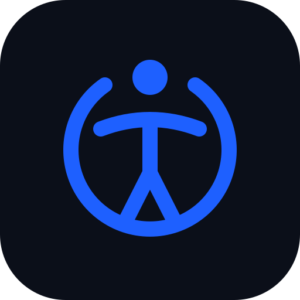

<p align="center">
  
</p>

<h1 align="center">Accessibility Manager</h1>

<p align="center">
  <strong>Fast, seamless, and intelligent Accessibility Service management for Android powered by Shizuku.</strong>
  <br />
  Bypass OEM 10-second countdown delays (MIUI / HyperOS), batch toggle services in custom groups, and take full control of your device accessibility with zero hassle.
</p>

<p align="center">
  <a href="../../releases"></a>
  
  
  
  
</p>

<p align="center">
  <a href="../../releases/latest">
    
  </a>
</p>

---

## ⚡ The Problem Accessibility Manager Solves

On modern Android devices—especially custom OEM interfaces like **Xiaomi MIUI / HyperOS**, **ColorOS**, **OxygenOS**, and others—enabling or toggling an Accessibility Service is notoriously tedious:

1. **Forced Warning Countdowns:** OEM firmware forces you to wait through aggressive 10-second warning countdowns before you can even confirm enablement.
2. **Deeply Nested Menus:** Navigating *Settings → Additional Settings → Accessibility → Downloaded Apps → Select App → Toggle On* takes dozens of taps every single time.
3. **No Batch Operations:** There is no native way to turn off battery-draining or intrusive accessibility services when not needed and switch them all back on with one tap.

**Accessibility Manager** eliminates these frustrations completely. By utilizing the elevated privileges of **Shizuku** (ADB / Root), Accessibility Manager interacts directly with Android's `WRITE_SECURE_SETTINGS` (`enabled_accessibility_services`), enabling or disabling any service **instantly in milliseconds with zero countdowns, zero warning prompts, and no root requirement.**

---

## ✨ Key Features

### ⚡ Instant One-Tap Toggling
Toggle any accessibility service on or off in a single tap. Changes take effect immediately at the system level without opening system settings dialogs or waiting through safety timers.

### 👥 App Groups & Batch Toggling
Group your accessibility apps based on workflow:
- **Work & Passwords** (Bitwarden, 1Password, KeePass)
- **Automation** (Tasker, Macrodroid, Automate)
- **Productivity & Utilities** (Dynamic Island, Volume Styles, Floating Menu)
- **Gaming & Performance** (Key mappers, Screen tools)

Toggle **an entire group ON or OFF with a single tap** when starting a game, heading to work, or saving battery!

### 📌 Pin Favorites to Top
Keep your most frequently adjusted apps right at your fingertips. Pin any service to lock it at the top of the list for quick access.

### 🔍 Real-Time Instant Search & Filtering
- Search across app names, package identifiers, and service class names.
- Quickly filter services by **All**, **Enabled Only**, or **Disabled Only** with interactive chips.

### 🚨 Emergency Master Controls
- **Enable All**: Turn on all detected services at once.
- **Disable All**: Instantly turn off all active accessibility services in an emergency or for troubleshooting, protected by a safety confirmation modal.

### 💾 Complete Backup & Restore (JSON)
Export your entire configuration—including your custom groups, pinned favorites, and active states—to a portable JSON backup file. Restore it effortlessly when switching devices or after a factory reset.

### 📊 Live Shizuku Status Monitoring
Interactive status dashboard providing real-time feedback on Shizuku availability, permission authorization status, and quick guides for Wireless ADB setup.

### 🎨 Modern Minimal Design & Material You
- Built 100% with modern **Jetpack Compose** and **Material Design 3 (M3)**.
- Dark & Light theme support with high-contrast, clean typography.
- Fluid edge-to-edge layout and accessible touch targets.

### 🛡️ 100% Private & Open Source
- **No Internet Permission Required:** Never connects to external servers.
- **Zero Ads, Zero Trackers:** All data and group configurations stay strictly local on your device inside an encrypted SQLite/Room database.

---

## 🚀 Getting Started

### Prerequisites

Accessibility Manager requires **[Shizuku](https://shizuku.rikka.app/)** to modify secure system settings without root:

1. Install **Shizuku** from [Google Play](https://play.google.com/store/apps/details?id=moe.shizuku.privileged.api) or [GitHub](https://github.com/RikkaApps/Shizuku/releases).
2. Start the Shizuku service via:
   - **Wireless Debugging** (Android 11+, no PC needed, easy on-device pairing)
   - **ADB via PC / Mac / Linux** (Android 8.0+)
   - **Root** (Magisk / KernelSU / APatch)

---

### Installation

1. Go to the **[Releases](../../releases)** section of this repository.
2. Download the latest `AccessibilityManager.apk` asset.
3. Install the APK on your Android device.
4. Open **Accessibility Manager** and grant Shizuku permission when prompted.
5. That's it! You can now manage and toggle all accessibility services instantly.

---

## 🛠️ Architecture & Tech Stack

Accessibility Manager is built following modern Android Architecture best practices:

- **Language:** Kotlin 100%
- **UI Framework:** Jetpack Compose (Material 3)
- **Architecture Pattern:** MVVM (Model-View-ViewModel) + Clean Architecture
- **Asynchronous Flow:** Kotlin Coroutines & `StateFlow`
- **Local Persistence:** Android Jetpack Room Database
- **IPC / Privilege Escalation:** [Shizuku API](https://github.com/RikkaApps/Shizuku) (`rikka.shizuku:api` & `provider`)
- **System Integration:** Direct Android Settings provider (`Settings.Secure.ENABLED_ACCESSIBILITY_SERVICES`)

```
com.example
├── data
│   ├── AccessibilityRepository.kt       # System settings & service manager
│   └── local                             # Room Database, DAOs & Entities (Groups, Pins)
├── model
│   ├── AccessibilityServiceItem.kt       # Domain model for accessibility services
│   └── AppGroupUiModel.kt               # Domain model for custom app groups
├── shizuku
│   └── ShizukuManager.kt                # Shizuku binder lifecycle, checks & commands
└── ui
    ├── AccessibilityScreen.kt            # Main Jetpack Compose screen & navigation
    ├── AccessibilityViewModel.kt         # Reactive StateFlow ViewModel
    ├── components/                       # Modular M3 cards, dialogs & search bars
    └── theme/                            # Material 3 ColorScheme, Typography & Shapes
```

---

## 🏗️ Building From Source

You can build the APK directly using Gradle:

```bash
# Clone the repository
git clone https://github.com/OWNER/REPO.git
cd REPO

# Build the debug APK
gradle assembleDebug

# Output APK will be located at:
# app/build/outputs/apk/debug/app-debug.apk
```

---

## 🤝 Contributing

Contributions, feature ideas, and pull requests are warmly welcomed!
- Found a bug or have a suggestion? Open an [Issue](../../issues).
- Want to contribute code? Fork the repository, create a feature branch, and submit a Pull Request.

---

## 📄 License

This project is licensed under the [Apache License 2.0](LICENSE) - see the LICENSE file for details.

---

<p align="center">
  Made with ❤️ for Android power users who value speed, efficiency, and complete device control.
</p>
